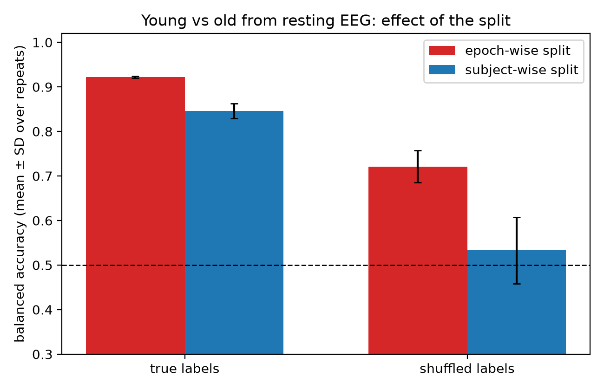

# Resting-state EEG: age-group classification and subject leakage

Two small self-directed analyses of public EEG data, written with MNE-Python and scikit-learn.
The main one measures how much random epoch splitting inflates classification accuracy when the
same person appears in both the training and the test data.

## Main result: leakage in age-group classification

**Data:** OpenNeuro ds005385 (Dortmund Vital Study), 64-channel resting-state EEG of healthy adults.
I used 40 subjects: 20 young (age 20 to 30) and 20 old (age 60 to 70), 10 per sex in each group, so a
classifier cannot use sex to separate the groups. Only recordings without late triggers were eligible.
Each subject contributes the session-1, eyes-closed, pre-task recording (about 3 minutes).

**Method:** 4 s epochs (1758 in total), 20 features per epoch (log band power in delta, theta, alpha and
beta, each as the median across channels in five regions: frontal, central, temporal, parietal, occipital),
standardized logistic regression, 5-fold cross-validation repeated 20 times with different splits.
Median re-referencing and a median-based regional feature keep one noisy electrode from affecting the results.

The same classifier was evaluated four ways:

| Labels | Random epoch split | Subject-wise split |
|---|---|---|
| True age labels | 0.92 | 0.85 |
| Shuffled labels (control) | 0.72 | 0.53 |

Balanced accuracy, mean over 20 repeats. Chance is 0.5. The standard deviation across repeats is in
`leakage_results.csv`.



**Reading the table**
- In the control, age labels are randomly reassigned between subjects, so the features contain no
  information about the labels. A random epoch split still reaches 72%, because the classifier
  recognizes individual subjects. A subject-wise split stays near chance.
- With true labels, the random split overestimates accuracy on new subjects by about 8 points (0.92 vs 0.85).
- Resting-state band power separates the two age groups on unseen subjects at roughly 85%.

## Second analysis: eyes open vs eyes closed alpha power

`eeg_alpha.py` uses the PhysioNet EEG Motor Movement/Imagery dataset (subjects 1 to 20, one minute eyes open
and one minute eyes closed). Occipital alpha power (8 to 12 Hz) was higher with eyes closed in 20 of 20
subjects (median ratio 7.4x, range 1.04x to 49x). A frontal control region also increased (16 of 20 subjects,
mean 2.6x), probably partly because of the average reference, which I did not test. The occipital increase
exceeded the frontal increase in all 20 subjects. The figure (`alpha_figure.png`) and the per-subject
numbers (`per_subject.csv`) from my run are in the repository root.

## Limitations

- 40 subjects. A rough binomial uncertainty on the 85% figure is about plus or minus 10 points. The
  standard deviations in the table only reflect different random fold assignments on the same people.
- Only the two extreme age groups were used, which makes the task easier. Ages 30 to 60 were left out.
- One dataset, one feature set, one classifier, no hyperparameter tuning, no external validation.
- Artifact handling is simple (amplitude-based epoch rejection and median-based features). No ICA.
- Healthy adults only. The analysis says nothing about clinical or neurodivergent groups.
- I did not check whether recording year or other site factors differ between the age groups.
- Not peer reviewed.

## Reproduce

```
pip install -r requirements.txt

# 1. participant table, then a sex-balanced subject list (seeded)
python -c "import openneuro as on; on.download(dataset='ds005385', target_dir='ds005385', include=['participants.tsv'])"
python select_subjects.py ds005385/participants.tsv --per-cell 10

# 2. download the 40 recordings (about 1 GB), extract features, run the test
python download_subjects.py subjects.csv
python extract_features.py subjects.csv
python leakage_test.py features.csv
```

`features.csv` and `subjects.csv` from my run are included, so `python leakage_test.py features.csv`
works without downloading anything.

`python test_pipeline.py` runs checks on synthetic data (feature extraction with a bad channel,
artifact rejection, and the leakage logic). These check the code, not the scientific result.

Second analysis: `python eeg_alpha.py --subjects 1-20 --out results` (MNE downloads the data).

## Files

| File | Purpose |
|---|---|
| `select_subjects.py` | Sex-balanced young and old subject list |
| `download_subjects.py` | Downloads the chosen recordings, with retries |
| `eegfeatures.py` | Epoching and band-power features (numpy and scipy only) |
| `extract_features.py` | Loads recordings with MNE and writes `features.csv` |
| `leakage_test.py` | The four-way comparison, table and figure |
| `test_pipeline.py` | Synthetic-data checks |
| `check_one.py` | Sanity check of one raw recording |
| `eeg_alpha.py` | Eyes open vs closed alpha analysis |
| `alpha_figure.png`, `per_subject.csv` | Output of `eeg_alpha.py` from my run |

## Data and references

- Getzmann S, Gajewski PD, Schneider D, Wascher E. Resting-state EEG data before and after cognitive activity
  across the adult lifespan and a 5-year follow-up. Scientific Data 11, 988 (2024).
  doi:10.1038/s41597-024-03797-w. OpenNeuro ds005385, doi:10.18112/openneuro.ds005385.v1.0.3 (CC0).
- Brookshire G, et al. Data leakage in deep learning studies of translational EEG. Frontiers in Neuroscience 18:1373515 (2024).
  This project reproduces the idea on a simple model; it does not replicate that paper.
- Schalk G, et al. BCI2000: a general-purpose brain-computer interface (BCI) system. IEEE Trans Biomed Eng 51(6), 2004;
  Goldberger AL, et al. PhysioBank, PhysioToolkit, and PhysioNet. Circulation 101(23), 2000.
  (EEG Motor Movement/Imagery dataset used in the second analysis.)
